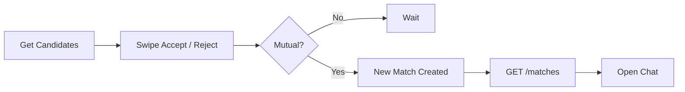

# Match Service API

The **Match Service** powers developer discovery, swipe actions, pending requests, and mutual matches in DevMatch.

This document is intended for frontend developers, backend integrations, and AI coding agents.

---

# Base URL

```text
/api/match
```

---

# Authentication

All endpoints require authentication.

Authentication is handled by the API Gateway.

The frontend sends:

```http
Authorization: Bearer <JWT>
```

The gateway validates the JWT and forwards the request internally with:

```http
x-user-id: <authenticated-user-id>
```

The Match Service never validates JWTs directly.

---

# Response Format

## Success

```json
{
  "success": true,
  "data": {}
}
```

## Error

```json
{
  "success": false,
  "message": "Human readable message",
  "errors": [
    {
      "field": "ratingMin",
      "issue": "Must be positive"
    }
  ]
}
```

---

# Enums

## IntentType

```text
DSA
HACKATHON
PROJECT
OPENSOURCE
```

## ActionType

```text
ACCEPTED
REJECTED
```

---

# Common Profile Object

```ts
{
  userId: string;
  username: string;
  displayName: string;
  avatarUrl: string | null;
  college: string | null;
  cfRating: number | null;
  profileScore: number;
  skillTags: string[];
}
```

---

# API Reference

---

# GET /candidates

Returns a ranked list of recommended developers.

## Query Parameters

| Parameter | Type | Required | Description |
|------------|------|----------|-------------|
| intentType | IntentType | ✅ | Matching intent |
| ratingMin | number | ❌ | Minimum Codeforces rating |
| ratingMax | number | ❌ | Maximum Codeforces rating |
| limit | number | ❌ | Default 20 (max 50) |
| page | number | ❌ | Default 1 |

---

## Example Request

```http
GET /match/candidates?intentType=DSA&ratingMin=1400&ratingMax=1600
```

---

## Success Response

```json
{
  "success": true,
  "data": {
    "candidates": [
      {
        "userId": "uuid",
        "username": "coder_aman",
        "displayName": "Aman Singh",
        "similarityScore": 0.988,
        "cfRating": 1550,
        "profileScore": 90,
        "skillTags": [
          "React",
          "TypeScript"
        ]
      }
    ],
    "relaxed": false,
    "relaxedStartIndex": 1,
    "totalAvailable": 1
  }
}
```

---

## Notes

- Results are sorted by similarity score.
- Previously seen users are excluded.
- Supports pagination.
- Progressive relaxation is automatically applied if no suitable candidates exist.

---

## Error Codes

| Status | Description |
|---------|-------------|
| 400 | Invalid query parameters |
| 500 | Internal server error |

---

# POST /action

Records a swipe action on another user.

If both users have accepted each other, a match is created.

---

## Request Body

```json
{
  "targetId": "uuid",
  "action": "ACCEPTED",
  "intentType": "DSA"
}
```

---

## Example Request

```http
POST /match/action
```

---

## Mutual Match Response (201)

```json
{
  "success": true,
  "data": {
    "action": "ACCEPTED",
    "isMutual": true,
    "matchId": "uuid"
  }
}
```

---

## Swipe Recorded (200)

```json
{
  "success": true,
  "data": {
    "action": "ACCEPTED",
    "isMutual": false,
    "matchId": null
  }
}
```

---

## Notes

- Safe to retry.
- Duplicate swipes are ignored.
- Users cannot swipe on themselves.
- Swipe actions are isolated per intent.

---

## Error Codes

| Status | Description |
|---------|-------------|
| 400 | Invalid request |
| 409 | Cannot swipe on yourself |
| 500 | Internal server error |

---

# GET /requests

Returns incoming connection requests that the current user has not responded to.

---

## Example Request

```http
GET /match/requests
```

---

## Success Response

```json
{
  "success": true,
  "data": {
    "requests": [
      {
        "userId": "uuid",
        "username": "saumya_dev",
        "displayName": "Saumya",
        "avatarUrl": "https://...",
        "requestedIntent": "HACKATHON",
        "requestedAt": "2026-06-30T10:00:00Z"
      }
    ]
  }
}
```

---

## Error Codes

| Status | Description |
|---------|-------------|
| 500 | Internal server error |

---

# GET /matches

Returns all mutual matches for the authenticated user.

Used for Conversations and Chat screens.

---

## Query Parameters

| Parameter | Type | Required | Description |
|------------|------|----------|-------------|
| intentType | IntentType | ❌ | Filter by intent |

---

## Example Request

```http
GET /match/matches?intentType=DSA
```

---

## Success Response

```json
{
  "success": true,
  "data": {
    "matches": [
      {
        "matchId": "uuid",
        "intentType": "DSA",
        "similarityScore": 0.988,
        "matchedAt": "2026-06-30T12:05:00Z",
        "matchedUser": {
          "id": "uuid",
          "username": "coder_aman",
          "displayName": "Aman Singh",
          "avatarUrl": "https://..."
        }
      }
    ]
  }
}
```

---

## Error Codes

| Status | Description |
|---------|-------------|
| 500 | Internal server error |

---

# Frontend Flow



---

# Typical User Journey

```text
GET /candidates
        │
        ▼
User swipes
        │
        ▼
POST /action
        │
        ▼
Mutual?
   │
 ┌─┴────────────┐
 │              │
No            Yes
 │              │
 ▼              ▼
Done      Match Created
                 │
                 ▼
        GET /matches
                 │
                 ▼
         Start Conversation
```

---

# HTTP Status Codes

| Code | Meaning |
|------|----------|
| 200 | Success |
| 201 | Resource created (Mutual match) |
| 400 | Invalid request |
| 409 | Business conflict |
| 500 | Internal server error |

---

# Notes

- Authentication is handled by the API Gateway.
- All responses use the same response envelope.
- All endpoints return JSON.
- Mutual matches are created automatically after two accepted swipes.
- Matching is isolated by `intentType`.