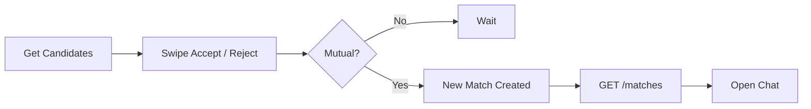

# Match Service API

The **Match Service** powers developer discovery, swipe actions, pending requests, and mutual matches in DevMatch.

This document is intended for frontend developers, backend integrations, and AI coding agents.

---

# Base URL

```text
/api/v1/match
```

---

# Authentication

All endpoints require authentication.

Authentication is handled by the API Gateway.

The frontend sends:

```http
Authorization: Bearer <JWT>
```

The gateway validates the JWT and forwards the request internally with:

```http
x-user-id: <authenticated-user-id>
```

The Match Service never validates JWTs directly.

---

# Response Format

## Success

```json
{
  "success": true,
  "data": {}
}
```

## Error

```json
{
  "success": false,
  "code": "INTENT_CONFIGURATION_REQUIRED",
  "message": "Human readable message",
  "details": {}
}
```

---

# Enums

## IntentType

```text
DSA
HACKATHON
PROJECT
OPENSOURCE
```

## ActionType

```text
ACCEPTED
REJECTED
```

---

# Common Profile Object

```ts
{
  userId: string;
  username: string;
  displayName: string;
  avatarUrl: string | null;
  college: string | null;
  cfRating: number | null;
  profileScore: number;
  skillTags: string[];
}
```

---

# API Reference

---

# GET /candidates

Returns a ranked list of recommended developers.

## Query Parameters

| Parameter | Type | Required | Description |
|------------|------|----------|-------------|
| intentRevision | number | ❌ | Latest revision returned by `/users/me/intents`; stale cache entries are reconstructed |
| limit | number | ❌ | Default 20 (max 50) |
| page | number | ❌ | Default 1 |

---

## Example Request

```http
GET /api/v1/match/candidates?intentRevision=12&limit=20&page=1
```

---

## Success Response

```json
{
  "success": true,
  "data": {
    "candidates": [
      {
        "userId": "uuid",
        "username": "coder_aman",
        "displayName": "Aman Singh",
        "technicalFitScore": 1,
        "similarityScore": 1,
        "compatibility": "HIGH",
        "levelBand": "NEAR",
        "levelSource": "CODEFORCES",
        "resolvedMatchMode": "DIRECT",
        "cfRating": 1550,
        "profileScore": 90,
        "matchedLanguages": ["cpp"],
        "matchedGoals": ["INTERVIEW_PREP"],
        "matchedFrameworks": [],
        "matchedDomains": [],
        "matchedRoles": [],
        "matchedContributionTypes": [],
        "matchedRepositoryTopics": [],
        "niceToHave": {
          "matchedGroupCount": 0,
          "totalGroupCount": 1,
          "matchedValueCount": 0
        },
        "capabilityEvidence": [],
        "reasonCodes": ["DSA_REQUIRED_CAPABILITIES_MATCHED"]
      }
    ],
    "totalAvailable": 1
  }
}
```

---

## Notes

- The active intent and its retained configuration come from `/users/me/intents`.
- Required groups filter candidates. Values within a group use OR; non-empty groups use AND.
- Nice-to-have values never filter and affect deterministic ordering only.
- Results sort by compatibility, nice-to-have group/value counts, technical fit, profile score, and user ID.
- Previously seen users are excluded.
- Supports pagination.

---

## Error Codes

| Status | Description |
|---------|-------------|
| 400 | Invalid pagination/revision parameters |
| 409 | Search intent or complete intent configuration required |
| 500 | Internal server error |

---

# GET /similar

Returns a ranked list of recommended developers based purely on vector similarity (Explore Tab).
No intent or rating filters are applied.

## Query Parameters

| Parameter | Type | Required | Description |
|------------|------|----------|-------------|
| limit | number | ❌ | Default 20 (max 50) |
| page | number | ❌ | Default 1 |

---

## Example Request

```http
GET /api/v1/match/similar
```

---

## Success Response

Same structure as `/candidates`.

---

## Error Codes

| Status | Description |
|---------|-------------|
| 500 | Internal server error |

---

# POST /action

Records a swipe action on another user.

If both users have accepted each other, a match is created.

---

## Request Body

```json
{
  "targetId": "uuid",
  "action": "ACCEPTED",
  "intentType": "DSA"
}
```

---

## Example Request

```http
POST /api/v1/match/action
```

---

## Mutual Match Response (201)

```json
{
  "success": true,
  "data": {
    "action": "ACCEPTED",
    "isMutual": true,
    "matchId": "uuid"
  }
}
```

---

## Swipe Recorded (200)

```json
{
  "success": true,
  "data": {
    "action": "ACCEPTED",
    "isMutual": false,
    "matchId": null
  }
}
```

---

## Notes

- Safe to retry.
- Duplicate swipes are ignored.
- Users cannot swipe on themselves.
- Swipe actions are isolated per intent.

---

## Error Codes

| Status | Description |
|---------|-------------|
| 400 | Invalid request / Cannot swipe on yourself |
| 500 | Internal server error |

---

# GET /requests

Returns incoming connection requests that the current user has not responded to.

---

## Example Request

```http
GET /api/v1/match/requests
```

---

## Success Response

```json
{
  "success": true,
  "data": {
    "requests": [
      {
        "userId": "uuid",
        "username": "saumya_dev",
        "displayName": "Saumya",
        "avatarUrl": "https://...",
        "college": "NIT",
        "profileScore": 85,
        "cfRating": 1450,
        "skillTags": [
          "React",
          "Node.js"
        ],
        "requestedIntent": "HACKATHON",
        "requestedAt": "2026-06-30T10:00:00Z"
      }
    ]
  }
}
```

---

## Error Codes

| Status | Description |
|---------|-------------|
| 500 | Internal server error |

---

# GET /matches

Returns all mutual matches for the authenticated user.

Used for Conversations and Chat screens.

---

## Example Request

```http
GET /api/v1/match/matches
```

---

## Success Response

```json
{
  "success": true,
  "data": {
    "matches": [
      {
        "matchId": "uuid",
        "intentType": "DSA",
        "similarityScore": 0.988,
        "matchedAt": "2026-06-30T12:05:00Z",
        "matchedUser": {
          "id": "uuid",
          "username": "coder_aman",
          "displayName": "Aman Singh",
          "avatarUrl": "https://..."
        }
      }
    ]
  }
}
```

---

## Error Codes

| Status | Description |
|---------|-------------|
| 500 | Internal server error |

---

# Frontend Flow



---

# Typical User Journey

```text
GET /candidates
        │
        ▼
User swipes
        │
        ▼
POST /action
        │
        ▼
Mutual?
   │
 ┌─┴────────────┐
 │              │
No            Yes
 │              │
 ▼              ▼
Done      Match Created
                 │
                 ▼
        GET /matches
                 │
                 ▼
         Start Conversation
```

---

# HTTP Status Codes

| Code | Meaning |
|------|----------|
| 200 | Success |
| 201 | Resource created (Mutual match) |
| 400 | Invalid request |
| 500 | Internal server error |

---

# Notes

- Authentication is handled by the API Gateway.
- All responses use the same response envelope.
- All endpoints return JSON.
- Mutual matches are created automatically after two accepted swipes.
- Matching is isolated by `intentType`.
