# 🚀 DevMatch — Match Service

> A high-performance, event-driven matchmaking engine that connects developers based on **technical compatibility**, **intent**, and **skill similarity** using vector-based recommendations.

---

## 📖 Table of Contents

- [Overview](#-overview)
- [Key Features](#-key-features)
- [System Goals](#-system-goals)
- [High-Level Architecture](#-high-level-architecture)
- [Core Components](#-core-components)
- [Architecture Principles](#-architecture-principles)

---

# 📌 Overview

The **Match Service** is the recommendation engine powering DevMatch.

Unlike traditional matchmaking platforms that rely on generic filters or random discovery, this service performs **intent-aware semantic matching** using vector similarity and progressive filtering.

Every developer can maintain multiple **Match Intents** (Hackathons, Open Source, Competitive Programming, Freelancing, etc.), allowing recommendations to be contextual rather than generic.

Instead of continuously querying relational data during every recommendation request, the service maintains an optimized Redis representation of the active matching pool and performs in-memory vector calculations for extremely low latency.

The service is designed around an **event-driven architecture**, ensuring cache consistency while keeping the matching pipeline fast and horizontally scalable.

---

# 🎯 System Goals

The Match Service is designed around the following engineering goals.

| Goal | Description |
|------|-------------|
| ⚡ Low Latency | Generate recommendations in milliseconds |
| 🎯 High Relevance | Match users using mathematical similarity rather than simple filters |
| 🔄 Event Driven | React to profile updates asynchronously |
| 📈 Horizontally Scalable | Multiple service instances without shared state |
| 🛡 Strong Consistency | PostgreSQL remains the source of truth |
| 🚀 Fast Read Performance | Redis powers recommendation queries |
| 🔒 Race Safe | Prevent duplicate matches during simultaneous swipes |

---

# ✨ Key Features

## 🎯 Intent Based Discovery

Every recommendation is generated for a specific developer intent.

Examples:

- Hackathons
- Open Source
- Competitive Programming
- Freelancing
- Startup Building
- Interview Preparation

Each intent maintains its own filters, history, and swipe state.

---

## 📐 Vector Similarity Matching

Instead of comparing only tags or skills, the Match Service calculates similarity using a **22-dimensional skill vector**.

This enables much more accurate recommendations.

The recommendation score is generated using **Cosine Similarity**, producing values between **0 and 1**, where higher values indicate stronger technical compatibility.

---

## 🔄 Progressive Relaxation

Strict filtering often produces empty candidate pools.

To prevent poor user experience, the recommendation engine gradually relaxes constraints until enough candidates are available.

The relaxation process follows this order:

```text
Strict Filters
      │
      ▼
Expand Rating Range
      │
      ▼
Reduce Similarity Threshold
      │
      ▼
Ignore Rating Constraint
      │
      ▼
Return Relaxed Candidates
```

This guarantees users rarely encounter an empty recommendation feed.

---

## ❤️ Swipe State Isolation

Every swipe is stored **per Intent**.

This means:

- Rejecting someone for Hackathons does not reject them for Freelancing.
- Each intent maintains an independent recommendation history.
- Duplicate recommendations are prevented efficiently.

---

## 🤝 Race-Safe Match Creation

The Match Service safely handles simultaneous right swipes.

Instead of distributed locking, PostgreSQL's unique constraints guarantee only one Match record can ever exist.

This removes the need for expensive distributed synchronization mechanisms.

---

## ⚡ Event Driven Cache Synchronization

The recommendation cache is never manually refreshed.

Instead:

- Profile Service publishes events.
- User Service publishes events.
- Match Service consumes events.
- Redis updates automatically.

The result is an always-fresh cache without synchronous coupling.

---

# 🏗 High-Level Architecture

The Match Service follows a layered microservice architecture.

- PostgreSQL stores authoritative data.
- Redis provides low-latency candidate retrieval.
- Kafka synchronizes distributed state.
- Express exposes REST APIs.
- Pure computation modules perform vector scoring and ranking.

---

## Architecture Diagram

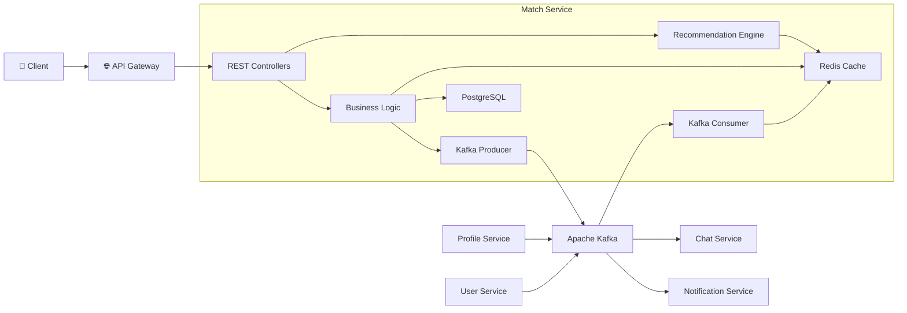

---

# 🔄 Service Interaction Overview

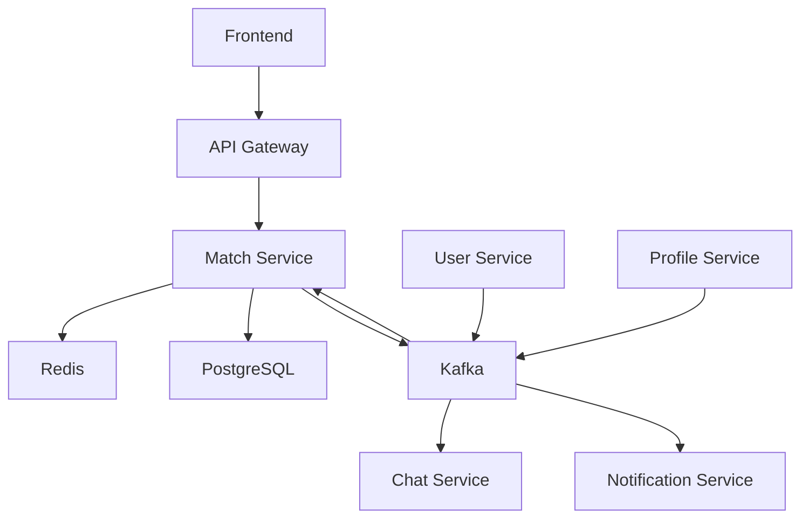

---

# 🧩 Core Components

| Component | Responsibility |
|------------|----------------|
| REST API | Handles HTTP requests |
| Recommendation Engine | Computes similarity and ranking |
| Filter Engine | Applies recommendation constraints |
| Match Service | Processes swipe actions |
| Redis Cache | Stores active recommendation pool |
| PostgreSQL | Source of truth |
| Kafka Consumer | Synchronizes cache |
| Kafka Producer | Publishes domain events |

---

# 🏛 Architecture Principles

The Match Service follows several architectural principles that influence every implementation decision.

---

## 1. PostgreSQL is the Source of Truth

Redis is treated purely as a cache.

No business-critical information exists exclusively inside Redis.

Whenever cache synchronization occurs, fresh data is fetched from PostgreSQL instead of trusting event payloads.

---

## 2. Stateless Compute Layer

Every Match Service instance can process any request.

No instance maintains local session state.

This enables effortless horizontal scaling behind a load balancer.

---

## 3. Event-Driven Communication

The service avoids direct synchronous communication wherever possible.

Instead, upstream services publish events to Kafka, allowing the Match Service to react asynchronously.

This significantly reduces service coupling.

---

## 4. Read Optimization

Recommendation generation is a read-heavy operation.

Instead of repeatedly joining multiple database tables, the service performs recommendations using an in-memory Redis dataset, drastically reducing latency.

---

## 5. Pure Recommendation Engine

All mathematical calculations are isolated into pure functions.

This provides:

- Easy unit testing
- Deterministic behavior
- Better maintainability
- Independent optimization

---

## 📊 Overall Request Lifecycle

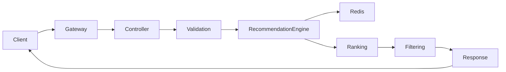

---

---

# 🔄 Complete Request Lifecycle

The Match Service is optimized around three primary workflows:

1. **Candidate Discovery (Intent-Based)** — generating a ranked feed filtered by intent and rating (`/candidates`).
2. **Candidate Discovery (Explore)** — generating a ranked feed based purely on global similarity (`/similar`).
3. **Swipe Resolution** — recording user actions and creating mutual matches.

Both workflows are designed to keep the API latency extremely low while maintaining consistency across distributed services.

---

# 📊 Runtime Request Flow

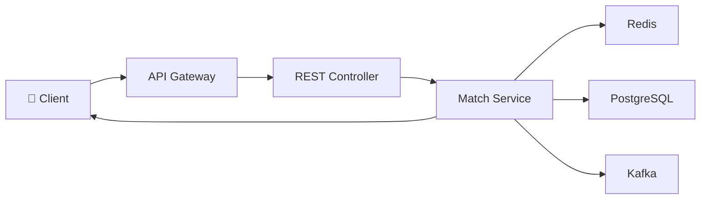

---

# 🎯 Candidate Recommendation Pipeline

Generating recommendations is the most read-intensive operation in the entire service.

Instead of querying PostgreSQL for every request, the service performs recommendation generation using an in-memory Redis dataset.

This significantly reduces latency while allowing complex mathematical ranking.

---

## Recommendation Pipeline

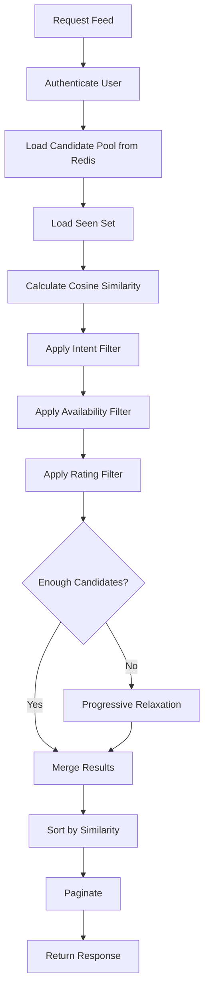

---

# 📥 Feed Generation Flow

## Step 1 — Authentication

The request first reaches the API Gateway.

Responsibilities:

- Validate JWT
- Reject unauthorized users
- Inject trusted internal headers
- Forward request internally

The Match Service never performs JWT verification itself.

Instead, it trusts the authenticated internal headers provided by the gateway.

---

## Step 2 — Load Candidate Pool

The Recommendation Engine loads the complete active matching pool from Redis.

Redis Operation

```text
HVALS match_profiles
```

The response contains every active candidate profile required for recommendation generation.

This operation typically completes in only a few milliseconds.

---

## Step 3 — Load Previously Seen Users

The service retrieves users already accepted or rejected for the requested intent.

Redis Key

```text
seen:{userId}:{intentType}
```

Redis Operation

```text
SMEMBERS
```

This prevents duplicate recommendations.

---

## Step 4 — Similarity Computation

Each remaining candidate is scored using Cosine Similarity.

Inputs include:

- 22-dimensional skill vector
- Technical profile
- Intent configuration

Output

```
Similarity Score

0.00 → Completely different

1.00 → Nearly identical
```

---

## Step 5 — Strict Filtering

Candidates are filtered according to:

| Filter | Description |
|---------|-------------|
| Intent | Same intent (Only for `/candidates`) |
| Availability | User must be available |
| Rating Range | Must fall inside configured range (Only for `/candidates`) |
| Similarity | Minimum similarity threshold |
| Seen History | Must not already be swiped (Checked against global seen list for `/similar`) |

Only candidates passing every filter continue.

---

## Step 6 — Progressive Relaxation

If strict filtering produces too few candidates, the engine gradually relaxes constraints.

This avoids empty recommendation feeds.

---

### Progressive Relaxation Flow

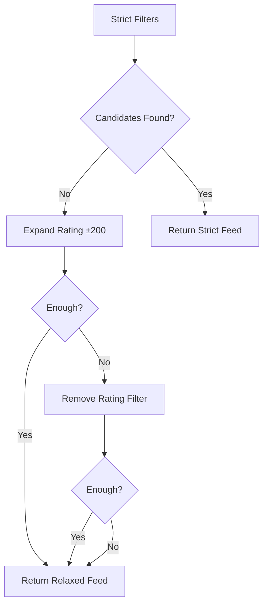

---

## Step 7 — Ranking

The final candidate pool is sorted using similarity score.

Highest similarity appears first.

Ranking is deterministic.

---

## Step 8 — Pagination

Only the requested page is returned.

The API additionally returns:

- relaxedStartIndex
- pagination metadata
- recommendation list

allowing the frontend to distinguish strict recommendations from relaxed recommendations.

---

# 📤 Feed Request Sequence Diagram

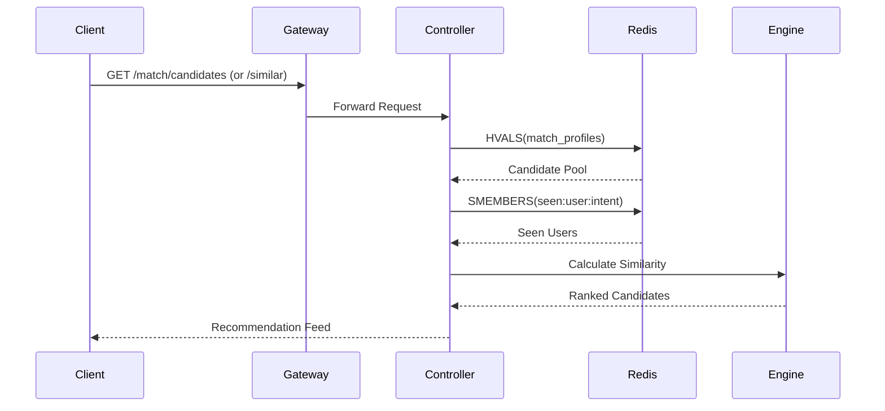

---

# ❤️ Swipe Action Lifecycle

Every swipe permanently records a user's intent-specific decision.

Actions supported:

| Action | Meaning |
|---------|----------|
| ACCEPT | User likes another profile |
| REJECT | User dismisses another profile |

---

## Swipe Processing Flow

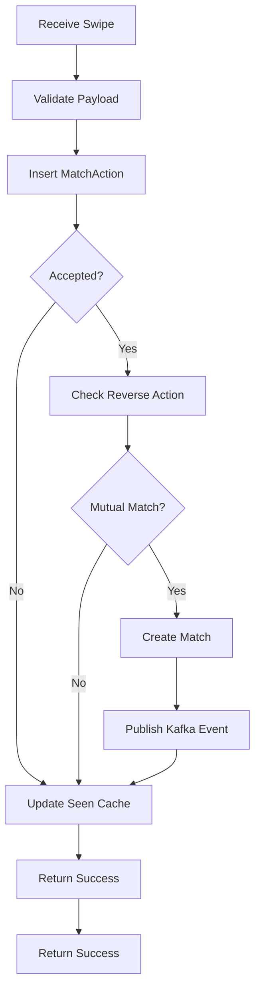

---

# 🔄 Swipe Resolution Sequence

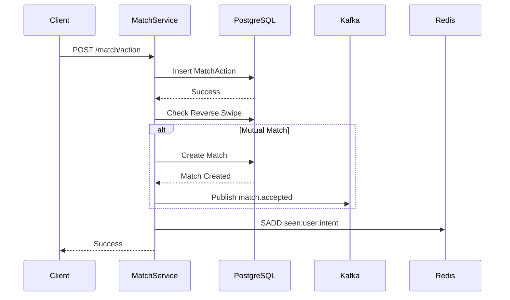

---

# 🤝 Mutual Match Resolution

Creating a match requires both users to explicitly accept each other.

The service never relies on distributed locks.

Instead, PostgreSQL guarantees uniqueness.

---

## Match Resolution State Machine

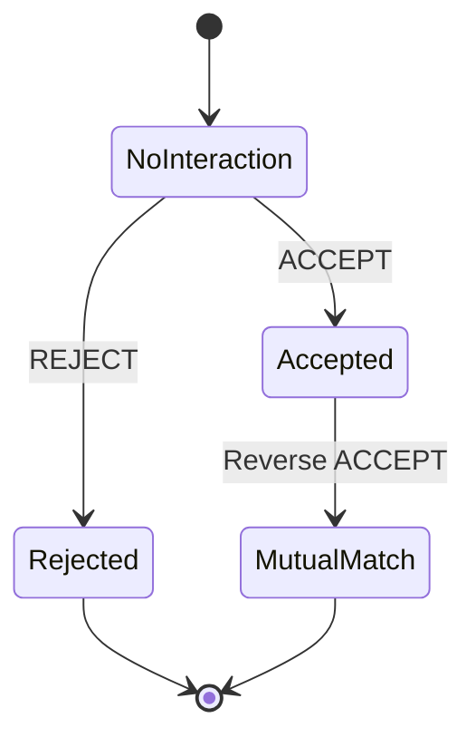

---

# 📥 Pending Requests Workflow

Pending Requests allow users to view incoming likes before they become mutual matches.

The service performs three operations:

1. Retrieve incoming ACCEPT actions.
2. Retrieve outgoing responses.
3. Remove requests already answered.

---

## Pending Request Flow

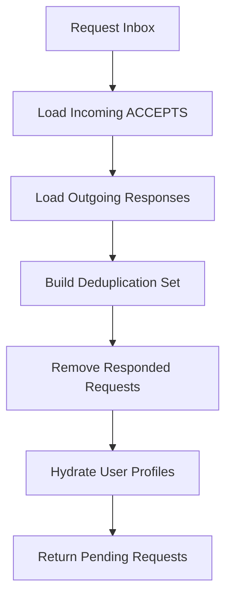

---

# 📋 Request Lifecycle Summary

| Workflow | Primary Store | Complexity |
|------------|--------------|------------|
| Candidate Feed | Redis | O(N) Similarity |
| Swipe Action | PostgreSQL | O(1) |
| Pending Requests | PostgreSQL | Indexed Query |
| Cache Lookup | Redis | O(1) |
| Seen Check | Redis Set | O(1) |
| Match Resolution | PostgreSQL | O(1) |

---
---

# 📡 Event-Driven Architecture

The Match Service follows an **event-driven architecture** to maintain cache consistency, reduce inter-service coupling, and enable independent scaling across the platform.

Instead of synchronously calling upstream services whenever profile data changes, the service reacts to domain events published on Kafka.

This architecture ensures:

- Loose coupling between services
- Eventual consistency
- Better fault tolerance
- Independent deployment of services
- High-throughput asynchronous processing

---

# 🏗 Event Flow Overview

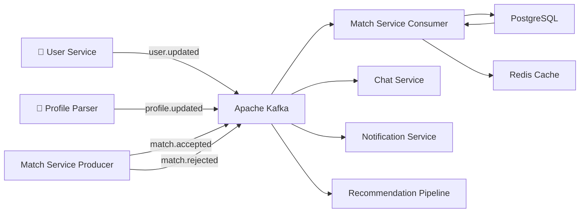

---

# 🎯 Why Kafka?

The Match Service performs millions of read operations over time while profile updates occur relatively infrequently.

Instead of forcing every recommendation request to query PostgreSQL, Kafka allows the cache to remain synchronized automatically.

This architecture eliminates unnecessary synchronous communication while ensuring Redis always reflects the latest valid profile state.

---

# 🚪 The Doorbell Pattern

One of the most important architectural decisions within the Match Service is the **Doorbell Pattern**.

Rather than sending complete profile information inside Kafka messages, upstream services publish only a notification that *something has changed*.

The Match Service then retrieves the latest data directly from PostgreSQL.

This guarantees that Redis is always synchronized using the authoritative source of truth.

---

## Doorbell Pattern Workflow

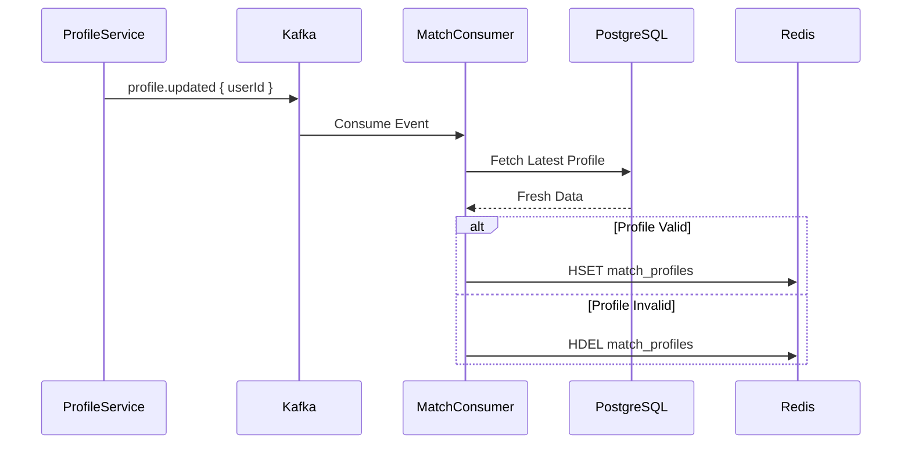

---

# 🚀 Kafka Topics

## Topics Consumed

| Topic | Producer | Consumer | Purpose |
|---------|----------|----------|----------|
| `profile.updated` | Profile Parser | Match Service | Refresh cached skill profile |
| `user.updated` | User Service | Match Service | Refresh availability, intent and metadata |

---

## Topics Produced

| Topic | Producer | Consumers | Purpose |
|---------|----------|------------|----------|
| `match.accepted` | Match Service | Chat Service, Notification Service | Notify successful mutual match |
| `match.rejected` | Match Service | ML Recommendation Pipeline | Collect negative feedback data |

---

# 📥 Consumer Pipeline

Every consumed Kafka event follows the exact same lifecycle.

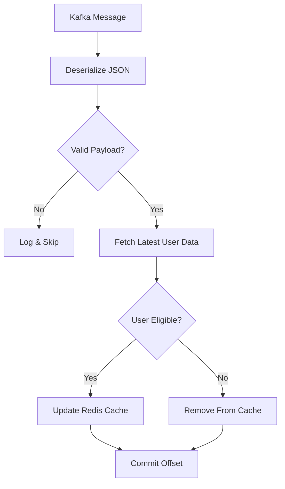

---

# 📤 Producer Pipeline

When business events occur, the Match Service publishes immutable domain events for downstream consumers.

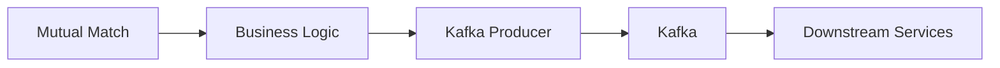

---

# 📨 Event Specifications

## profile.updated

### Purpose

Synchronizes cached profile information after technical profile updates.

---

### Producer

Profile Parser Service

---

### Consumer

Match Service

---

### Partition Key

```text
userId
```

---

### Payload

```json
{
  "userId": "3f65c4d0-71ce-4d97-a36f-2a0cde2f0d39"
}
```

---

### Processing

1. Receive event
2. Fetch latest profile
3. Validate eligibility
4. Update Redis

---

## user.updated

### Purpose

Synchronizes user metadata including:

- Availability
- Match intents
- Rating configuration

---

### Producer

User Service

---

### Consumer

Match Service

---

### Payload

```json
{
  "userId": "3f65c4d0-71ce-4d97-a36f-2a0cde2f0d39"
}
```

---

## match.accepted

Published after a successful mutual match.

---

### Producer

Match Service

---

### Consumers

| Consumer | Responsibility |
|-----------|---------------|
| Chat Service | Create chat room |
| Notification Service | Push notification |

---

### Payload

```json
{
  "matchId": "uuid",
  "userAId": "uuid",
  "userBId": "uuid",
  "intentType": "HACKATHON",
  "similarityScore": 0.94,
  "timestamp": "2026-06-30T14:32:41Z"
}
```

---

## match.rejected

Represents negative user feedback.

This event enables future recommendation improvements without affecting the online recommendation engine.

---

### Producer

Match Service

---

### Consumer

Recommendation Pipeline

---

### Payload

```json
{
  "actorId": "uuid",
  "targetId": "uuid",
  "intentType": "DSA"
}
```

---

# 🔄 Cache Synchronization Lifecycle

The Redis cache continuously evolves through Kafka events.

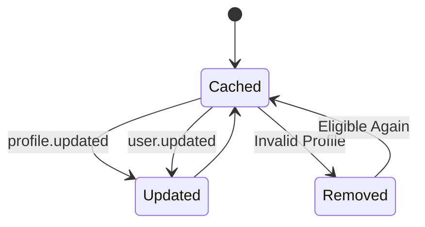

---

# 🧠 Redis Architecture

Redis serves as the primary operational datastore for recommendation generation.

Instead of querying PostgreSQL repeatedly, the service performs all recommendation calculations using cached data.

---

## Redis Data Layout

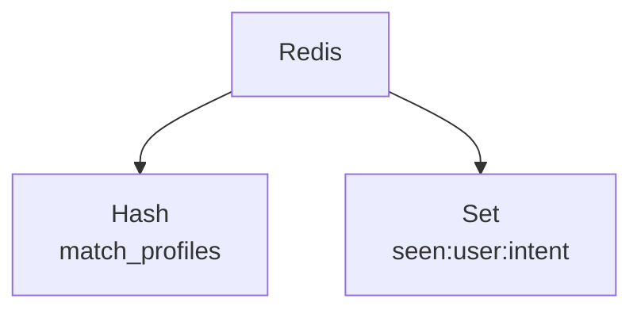

---

# 📦 Redis Data Structures

| Redis Key | Data Type | Purpose |
|------------|-----------|----------|
| `match_profiles` | Hash | Active recommendation pool |
| `seen:{userId}:{intent}` | Set | Previously accepted/rejected profiles |

---

# 🗂 Candidate Cache

## Key

```text
match_profiles
```

---

### Type

Redis Hash

---

### Structure

```text
match_profiles

├── userId_1 → MatchProfile JSON

├── userId_2 → MatchProfile JSON

├── userId_3 → MatchProfile JSON

└── ...
```

---

### Primary Operations

| Command | Purpose |
|----------|----------|
| HVALS | Load recommendation pool |
| HSET | Update cached profile |
| HDEL | Remove inactive profile |

---

# 🚫 Seen History Cache

Every intent maintains an independent exclusion set.

---

## Key Pattern

```text
seen:{userId}:{intentType}
```

Example

```text
seen:123:HACKATHON
```

---

### Type

Redis Set

---

### Operations

| Command | Purpose |
|----------|----------|
| SADD | Store swipe |
| SMEMBERS | Load history |
| SISMEMBER | Duplicate detection |

---

## Seen Set Lifecycle

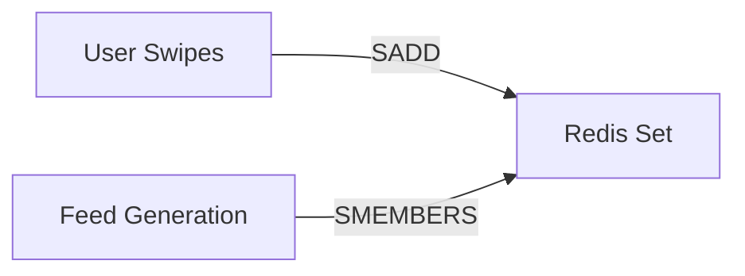

---

# ❓ Why Redis?

Redis was selected because recommendation generation is overwhelmingly read-heavy.

The recommendation engine can retrieve thousands of candidate profiles in a few milliseconds using a single `HVALS` operation.

Combined with in-memory vector computation, this eliminates expensive relational joins during every recommendation request while maintaining excellent response times.

---

# 🚫 Why BullMQ Is Not Used

Unlike other platform services, the Match Service does **not** require BullMQ.

Every critical workflow completes within a single request lifecycle:

- Similarity computation
- Swipe persistence
- Match creation
- Cache updates

Cross-service communication is already handled asynchronously through Kafka.

Introducing BullMQ would duplicate responsibilities already provided by Kafka while increasing operational complexity through additional queues, workers, retries, and monitoring.

As a result, Kafka alone provides all asynchronous messaging requirements for the Match Service while keeping the architecture significantly simpler.
---

# 🗄 Database Architecture

PostgreSQL serves as the **single source of truth** for the Match Service.

While Redis accelerates recommendation generation, every critical business operation—including swipe persistence, match creation, and relationship management—is ultimately backed by PostgreSQL.

The database is responsible for:

- Persisting user actions
- Maintaining relationship integrity
- Preventing duplicate matches
- Enforcing transactional consistency
- Supporting recovery after cache failures

---

# 🏛 Data Ownership

| Component | Responsibility |
|------------|----------------|
| PostgreSQL | Source of truth |
| Redis | Read optimization & cache |
| Kafka | Event propagation |
| Match Service | Business logic |
| Recommendation Engine | Candidate ranking |

---

# 🧩 Entity Relationship Diagram

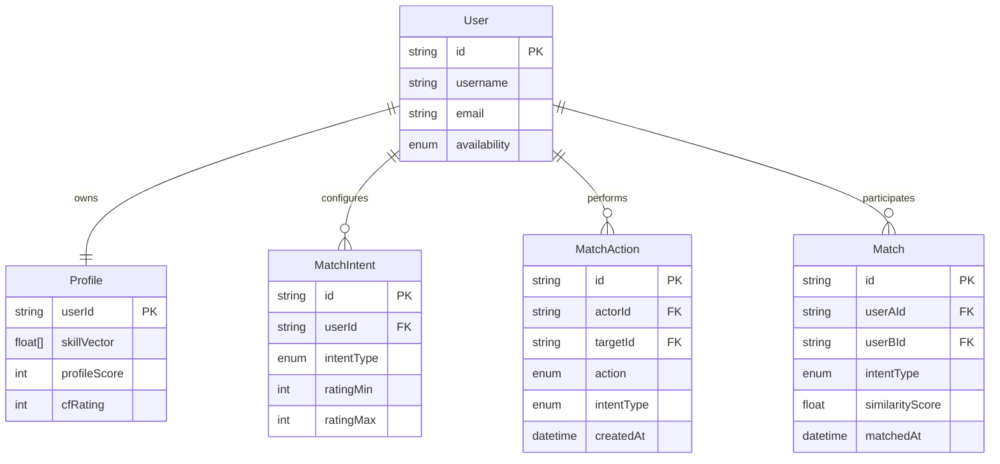

---

# 📚 Core Entities

## User

Represents the platform user.

Stores authentication-independent information such as:

- Availability
- Identity
- Account metadata

---

## Profile

Contains technical information used by the recommendation engine.

Examples include:

- Skill vector
- Profile score
- Competitive programming rating
- Technical metadata

The Profile entity directly influences recommendation quality.

---

## MatchIntent

A user can participate in multiple independent matching contexts.

Each intent maintains its own configuration.

Examples:

- Hackathons
- Open Source
- Freelancing
- Competitive Programming

Each intent stores its own:

- Rating boundaries
- Availability preferences
- Recommendation settings

---

## MatchAction

Acts as the immutable history of every swipe.

Every Accept or Reject action creates a MatchAction record.

This table enables:

- Recommendation exclusion
- Pending requests
- Match detection
- Historical analytics

---

## Match

Represents a successful mutual match.

A Match is created only when both users explicitly accept one another for the same intent.

Once created, Match records are immutable.

---

# 🔗 Database Relationships

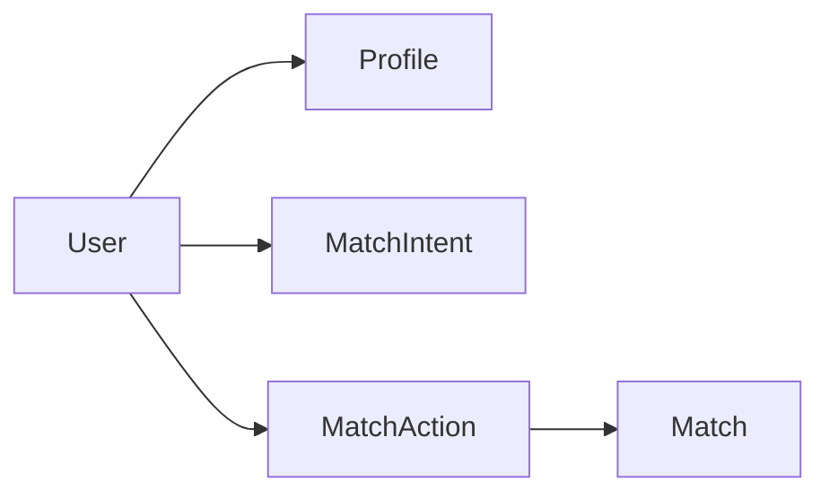

---

# ⚡ Swipe Persistence

Every swipe follows the same persistence lifecycle.

```mermaid
flowchart TD

Request["Swipe Request"]

Insert["Insert MatchAction"]

Check["Lookup Reverse Swipe"]

Decision{"Mutual?"}

Match["Create Match"]

Finish["Return Success"]

Request --> Insert

Insert --> Check

Check --> Decision

Decision -- Yes --> Match

Decision -- No --> Finish

Match --> Finish
```

---

# 🤝 Match Creation Strategy

Creating duplicate matches is one of the biggest risks in any social matching platform.

Instead of introducing distributed locks, the Match Service delegates this responsibility to PostgreSQL.

The service always stores participants in a deterministic order:

```text
userAId = lexicographically smaller UUID

userBId = lexicographically larger UUID
```

This guarantees both requests attempt to insert exactly the same row.

---

## Race Condition Resolution

```mermaid
sequenceDiagram

participant UserA

participant UserB

participant MatchService

participant PostgreSQL

UserA->>MatchService: ACCEPT UserB

UserB->>MatchService: ACCEPT UserA

MatchService->>PostgreSQL: INSERT Match

alt First Transaction

PostgreSQL-->>MatchService: Success

else Duplicate

PostgreSQL-->>MatchService: Unique Constraint (P2002)

end

MatchService-->>UserA: Match Created

MatchService-->>UserB: Match Created
```

---

# 🛡 Duplicate Prevention

The Match table enforces uniqueness through a composite constraint.

| Constraint | Purpose |
|------------|----------|
| `(userAId, userBId, intentType)` | Prevent duplicate matches |

This removes the need for:

- Distributed locks
- Leader election
- External coordination services

---

# ⚙ Database Indexing Strategy

Proper indexing ensures that recommendation-related queries remain performant.

| Table | Index | Purpose |
|--------|-------|----------|
| MatchAction | actorId | User swipe history |
| MatchAction | targetId | Pending requests |
| MatchAction | actorId + intentType | Feed exclusion |
| MatchIntent | userId | Intent lookup |
| Match | userAId | Match retrieval |
| Match | userBId | Match retrieval |
| Match | intentType | Intent filtering |

---

# 🔍 Query Responsibilities

| Operation | Primary Table |
|------------|---------------|
| Save Swipe | MatchAction |
| Reverse Swipe Lookup | MatchAction |
| Pending Requests | MatchAction |
| Mutual Match | Match |
| User Intent | MatchIntent |
| Technical Profile | Profile |

---

# 📂 Project Structure

The Match Service follows a layered architecture that separates transport, business logic, infrastructure, and domain logic.

This organization keeps each layer focused on a single responsibility and makes the codebase easier to maintain and extend.

---

## Folder Structure

```text
apps/
└── match-service/
    ├── src/
    │   ├── handlers/
    │   ├── middleware/
    │   ├── routes/
    │   ├── services/
    │   │   ├── cache/
    │   │   ├── engine/
    │   │   ├── kafka/
    │   │   └── match.service.ts
    │   ├── scripts/
    │   └── index.ts
    ├── package.json
    ├── tsconfig.json
    └── README.md
```

---

# 📁 Folder Responsibilities

| Folder | Responsibility |
|----------|---------------|
| handlers | Thin HTTP controllers responsible only for request parsing and response formatting |
| middleware | Internal middleware such as authenticated user extraction |
| routes | Express route registration |
| services/cache | Redis client and cache management |
| services/engine | Recommendation algorithms, ranking and filtering |
| services/kafka | Kafka producers and consumers |
| services | Core business logic and database interactions |
| scripts | Local development and testing utilities |

---

# 🧠 Recommendation Engine

The recommendation engine is intentionally isolated from infrastructure concerns.

It consists entirely of deterministic, testable modules.

```mermaid
flowchart LR

Candidates

--> CosineSimilarity

--> FilterEngine

--> ProgressiveRelaxation

--> Ranking

--> FinalFeed
```

---

## Engine Components

| Component | Responsibility |
|------------|----------------|
| cosine.ts | Calculates cosine similarity between skill vectors |
| filter.ts | Applies recommendation constraints |
| ranker.ts | Executes progressive relaxation and ranking |
| types.ts | Shared domain models |

---

# 🔄 Service Startup Lifecycle

The Match Service follows a predictable startup sequence.

No HTTP traffic is accepted until infrastructure dependencies are initialized.

```mermaid
flowchart TD

Start["Application Start"]

Redis["Connect Redis"]

Database["Connect PostgreSQL"]

Kafka["Connect Kafka"]

Consumer["Start Kafka Consumer"]

Routes["Register Routes"]

Server["Start HTTP Server"]

Start --> Redis

Redis --> Database

Database --> Kafka

Kafka --> Consumer

Consumer --> Routes

Routes --> Server
```

---

# 🚀 Request Responsibility Matrix

| Layer | Responsibility |
|--------|----------------|
| Controller | Parse HTTP request |
| Middleware | Extract authenticated user |
| Match Service | Business logic |
| Recommendation Engine | Candidate ranking |
| Redis | Fast recommendation data |
| PostgreSQL | Durable persistence |
| Kafka | Event propagation |

---

# 📦 Dependency Overview

```mermaid
graph TD

Controller --> MatchService

MatchService --> RecommendationEngine

MatchService --> Redis

MatchService --> PostgreSQL

MatchService --> KafkaProducer

KafkaConsumer --> Redis

RecommendationEngine --> FilterEngine

RecommendationEngine --> CosineSimilarity
```
---

---

# 🏛 Architectural Decision Records (ADR)

Every significant architectural choice in the Match Service was made after evaluating multiple alternatives.

This section documents **what decision was made, why it was chosen, what alternatives were considered, and the associated trade-offs**.

---

## ADR-001 — In-Memory Recommendation Engine

### Context

Recommendation generation is the most frequently executed operation in the service.

Running complex SQL joins and similarity calculations for every request would significantly increase response latency.

### Decision

Load active candidate profiles into memory from Redis and perform all similarity calculations inside Node.js using pure functions.

### Consequences

✅ Extremely low latency

✅ Easily testable

✅ Database remains lightly loaded

⚠ Memory usage grows with active users.

---

## ADR-002 — PostgreSQL as the Source of Truth

### Context

Redis provides exceptional read performance but should never become the authoritative datastore.

### Decision

Treat Redis as a disposable cache.

Whenever profile data changes, always reload fresh data from PostgreSQL.

### Benefits

- Strong consistency
- Easy cache rebuilding
- No stale writes
- Predictable recovery

---

## ADR-003 — The Doorbell Pattern

### Context

Kafka payloads may become stale if multiple profile updates occur in quick succession.

### Decision

Kafka events only contain identifiers.

Consumers always query PostgreSQL for fresh data.

### Why?

This completely eliminates stale cache synchronization.

---

## ADR-004 — Event-Driven Communication

### Context

Direct HTTP communication between services creates tight coupling.

### Decision

Communicate asynchronously through Kafka.

### Benefits

- Independent deployments
- Better resiliency
- Horizontal scalability
- Retry capability
- Loose coupling

---

## ADR-005 — Stateless Service Design

Every Match Service instance is completely stateless.

No session data is stored locally.

Any instance can process any request.

This enables effortless horizontal scaling behind a load balancer.

---

## ADR-006 — Database-Enforced Race Resolution

Instead of implementing distributed locking,

the service relies on PostgreSQL's unique constraints to prevent duplicate matches.

This dramatically simplifies the architecture while maintaining correctness.

---

# 📋 Architectural Decision Summary

| Decision | Chosen Solution | Alternative | Reason |
|-----------|----------------|------------|--------|
| Recommendation Engine | In-memory vector computation | pgvector | Faster MVP implementation |
| Source of Truth | PostgreSQL | Redis | Strong consistency |
| Cache Updates | Doorbell Pattern | Event payload synchronization | Eliminates stale cache |
| Service Communication | Kafka | REST calls | Loose coupling |
| Match Resolution | Unique DB constraint | Distributed lock | Simpler and safer |
| Service State | Stateless | Sticky sessions | Horizontal scalability |

---

# 📈 Scalability

The Match Service is intentionally designed so that each layer can scale independently.

```mermaid
flowchart LR

Client

-->

LoadBalancer

-->

API1

API2

API3

API1 --> Redis

API2 --> Redis

API3 --> Redis

API1 --> PostgreSQL

API2 --> PostgreSQL

API3 --> PostgreSQL

Kafka --> API1

Kafka --> API2

Kafka --> API3
```

---

# Horizontal Scaling

The service itself stores no session state.

Therefore multiple replicas can run simultaneously without synchronization.

Benefits include:

- Higher throughput
- Fault tolerance
- Zero session affinity
- Easier deployments

---

# Kafka Scaling

Kafka distributes partitions among multiple Match Service instances.

```mermaid
flowchart LR

Topic["profile.updated"]

P1["Partition 0"]

P2["Partition 1"]

P3["Partition 2"]

C1["Instance A"]

C2["Instance B"]

C3["Instance C"]

Topic --> P1

Topic --> P2

Topic --> P3

P1 --> C1

P2 --> C2

P3 --> C3
```

This enables parallel event processing without duplicate consumption.

---

# Redis Scaling

Redis handles recommendation reads.

Current strategy:

- Single Hash
- In-memory recommendation pool
- O(1) access
- Very low latency

Future improvements may include:

- Redis Cluster
- Read replicas
- Sharding

---

# Database Scaling

Write traffic is relatively low compared to recommendation reads.

Current scaling strategy:

- Indexed tables
- Connection pooling
- Optimized queries

Future scaling options include:

- Read replicas
- Partitioning
- CQRS
- pgvector

---

# Current Bottlenecks

The recommendation engine currently loads the active candidate pool into memory.

While this is extremely fast for tens of thousands of users,

it eventually becomes memory intensive.

Current practical limits are roughly:

| Users | Performance |
|--------|-------------|
| 1K | Excellent |
| 10K | Excellent |
| 50K | Good (memory increases) |
| 100K+ | Requires architecture upgrade |

---

# Future Scaling Path

```mermaid
flowchart LR

Redis

-->

Node.js Ranking

-->

Large Memory Usage

-->

pgvector

-->

ANN Search

-->

Million+ Users
```

---

# ⚠ Failure Scenarios

Even highly available systems experience failures.

The Match Service is designed to degrade gracefully whenever possible.

---

## Failure Matrix

| Failure | Impact | Recovery |
|----------|---------|----------|
| Redis unavailable | Recommendation latency increases | Query PostgreSQL |
| Kafka unavailable | Cache updates delayed | Retry consumer |
| PostgreSQL unavailable | Writes blocked | Retry / fail request |
| Duplicate Kafka event | Safe | Idempotent consumer |
| Duplicate swipe | Safe | Unique DB constraint |
| Malformed Kafka message | Ignored | Validation + logging |

---

## Redis Failure

```mermaid
flowchart TD

Redis

-->

Failure

-->

Fallback

-->

PostgreSQL

-->

Recommendation

-->

Response
```

If Redis becomes unavailable,

the service gracefully falls back to PostgreSQL.

Latency increases,

but the API remains operational.

---

## Kafka Failure

If Kafka becomes temporarily unavailable:

- API requests continue working.
- Recommendation generation continues.
- Cache synchronization pauses.
- Consumers automatically reconnect.

---

## Poison Message Handling

```mermaid
flowchart TD

KafkaMessage

-->

Deserialize

-->

Valid?

Valid? -- No --> Skip

Valid? -- Yes --> Process
```

Malformed events never crash the consumer.

Instead they are logged and skipped.

---

## Duplicate Swipe Handling

Simultaneous swipes are expected.

Instead of locking:

1. Attempt database insert.
2. PostgreSQL detects duplicates.
3. Unique constraint triggers.
4. Service returns success.

This guarantees correctness while avoiding distributed locking.

---

# 🔐 Reliability Characteristics

| Property | Status |
|------------|--------|
| Idempotent Swipes | ✅ |
| Event Driven | ✅ |
| Stateless API | ✅ |
| Horizontally Scalable | ✅ |
| Cache Consistency | ✅ |
| Duplicate Match Prevention | ✅ |
| Eventual Consistency | ✅ |
---

# 🚀 Future Improvements

Although the current architecture is production-ready for an MVP and medium-scale deployment, several enhancements have been identified to improve scalability, reliability, observability, and operational excellence as the platform grows.

---

## 📈 Scalability Roadmap

| Improvement | Current Approach | Future Direction | Benefit |
|--------------|------------------|------------------|----------|
| Recommendation Engine | Redis + In-memory Ranking | pgvector / Dedicated Vector Database | Scalable nearest-neighbor search |
| Redis | Single Instance | Redis Cluster | High availability & horizontal scaling |
| PostgreSQL | Single Primary | Read Replicas | Improved read throughput |
| Kafka | Basic Topics | Schema Registry + Versioning | Safer event evolution |
| Cache | Manual Synchronization | Automated TTL & Refresh | Reduced stale cache risk |

---

## 🧠 Vector Database Migration

The current recommendation engine computes similarity by loading active profiles into memory and performing cosine similarity calculations.

This approach performs exceptionally well for small and medium-sized datasets but eventually becomes memory-bound as the active user base grows.

A future migration to a vector database such as **pgvector** (using HNSW indexing) would allow approximate nearest-neighbor (ANN) search directly within the database, reducing both memory consumption and recommendation latency at large scale.

```mermaid
flowchart LR

Current["Redis Cache + Node.js Ranking"]

-->

Growth["Growing Active Users"]

-->

pgvector["pgvector / Vector Database"]

-->

ANN["Approximate Nearest Neighbor Search"]

-->

LargeScale["Million+ Candidate Support"]
```

---

# 📦 Transactional Outbox Pattern

Currently, a `match.accepted` event is published **after** the database transaction commits.

Although this works well under normal conditions, there is a small window where the database commit succeeds but Kafka publishing fails.

This could result in downstream services never receiving the event.

A Transactional Outbox Pattern would eliminate this possibility.

```mermaid
flowchart LR

Application

-->

PostgreSQL

-->

OutboxTable

-->

OutboxWorker

-->

Kafka

-->

Consumers
```

### Benefits

- Guaranteed event delivery
- Elimination of lost events
- Reliable recovery after crashes
- Improved auditability

---

# 📡 Event Versioning

As more services integrate with the Match Service, event schemas will naturally evolve.

Introducing event versioning ensures backward compatibility between producers and consumers.

Example:

```text
profile.updated.v1

profile.updated.v2

match.accepted.v1
```

This allows older services to continue functioning while newer versions are gradually adopted.

---

# 🔍 Distributed Tracing

Currently, requests are logged independently by each service.

Future implementations should introduce distributed tracing using OpenTelemetry.

A single Trace ID would propagate through:

- API Gateway
- Match Service
- Kafka
- Chat Service
- Notification Service

```mermaid
flowchart LR

Client

-->

Gateway

-->

MatchService

-->

Kafka

-->

ChatService

Gateway -. Trace ID .-> MatchService

MatchService -. Trace ID .-> Kafka

Kafka -. Trace ID .-> ChatService
```

This would greatly simplify debugging and performance analysis across the platform.

---

# 📊 Observability

A production deployment should expose operational metrics for monitoring.

Suggested metrics include:

| Metric | Purpose |
|----------|----------|
| Recommendation latency | API performance |
| Redis hit rate | Cache efficiency |
| Kafka consumer lag | Event processing health |
| Match creation rate | Product analytics |
| Cache synchronization time | Event propagation latency |
| Active recommendation pool size | Capacity planning |
| API request throughput | Traffic monitoring |
| Recommendation generation time | Performance tuning |

---

# 📝 Structured Logging

Every request should produce structured logs that include:

```json
{
  "traceId": "...",
  "userId": "...",
  "intentType": "HACKATHON",
  "endpoint": "/match/candidates",
  "durationMs": 8,
  "status": 200
}
```

Structured logs significantly improve production debugging and enable efficient querying in centralized logging platforms.

---

# 🔐 Security Considerations

The Match Service assumes that all incoming requests originate from the internal API Gateway.

Security considerations include:

- Internal network isolation
- Header spoofing prevention
- Service-to-service authentication
- Principle of least privilege
- Secure Kafka communication
- Redis authentication
- Database credential rotation

---

# 🧪 Testing Strategy

A robust testing strategy ensures confidence during development and deployment.

| Test Type | Purpose |
|------------|----------|
| Unit Tests | Validate recommendation algorithms |
| Integration Tests | Verify database and Redis interactions |
| API Tests | Validate endpoint behavior |
| Kafka Tests | Verify producer/consumer workflows |
| Load Tests | Measure recommendation performance |
| End-to-End Tests | Validate complete user flows |

---

# 📚 Key Engineering Takeaways

The Match Service demonstrates several distributed systems principles in practice:

- Stateless microservice design
- Event-driven communication
- Cache-aside synchronization
- Immutable event publishing
- Database-enforced consistency
- Optimistic concurrency control
- Separation of compute and storage
- Pure-function recommendation engine
- Progressive recommendation strategies

These principles make the service maintainable, scalable, and resilient while keeping operational complexity under control.

---

# 📌 Summary

The **DevMatch Match Service** is a high-performance recommendation engine built around modern distributed systems principles.

Rather than relying on expensive relational queries for every recommendation request, it maintains a continuously synchronized Redis cache that enables low-latency, in-memory recommendation generation using vector similarity.

Kafka serves as the communication backbone, allowing upstream profile changes and downstream match events to propagate asynchronously without introducing tight coupling between services.

PostgreSQL remains the authoritative source of truth, ensuring strong consistency for all business-critical operations, while Redis is used exclusively as a performance optimization layer.

Race conditions during mutual matches are resolved through deterministic ordering and database constraints rather than distributed locking, simplifying the architecture while maintaining correctness.

By combining event-driven synchronization, stateless service design, pure recommendation algorithms, and optimized caching strategies, the Match Service provides a scalable foundation capable of supporting future enhancements such as vector databases, transactional outbox patterns, distributed tracing, and advanced observability.

---

# 📖 Glossary

| Term | Description |
|------|-------------|
| Intent | A specific context in which a user wants to connect (e.g., Hackathon, Open Source). |
| Skill Vector | A numerical representation of a developer's technical skills used for similarity calculations. |
| Cosine Similarity | Mathematical metric used to measure similarity between two skill vectors. |
| Progressive Relaxation | Gradually relaxing recommendation filters to avoid empty candidate feeds. |
| Doorbell Pattern | Publishing lightweight events that notify consumers to fetch fresh data from the source of truth instead of trusting event payloads. |
| MatchAction | A record of a user's Accept or Reject action. |
| Match | A mutual connection created after both users accept each other. |
| Source of Truth | The authoritative datastore (PostgreSQL) responsible for maintaining correct system state. |
| Eventual Consistency | A consistency model where distributed components become synchronized over time through asynchronous events. |

---

> **Architecture Philosophy:**  
> *"Keep writes strongly consistent, make reads exceptionally fast, and allow events—not synchronous dependencies—to keep distributed components in sync."*